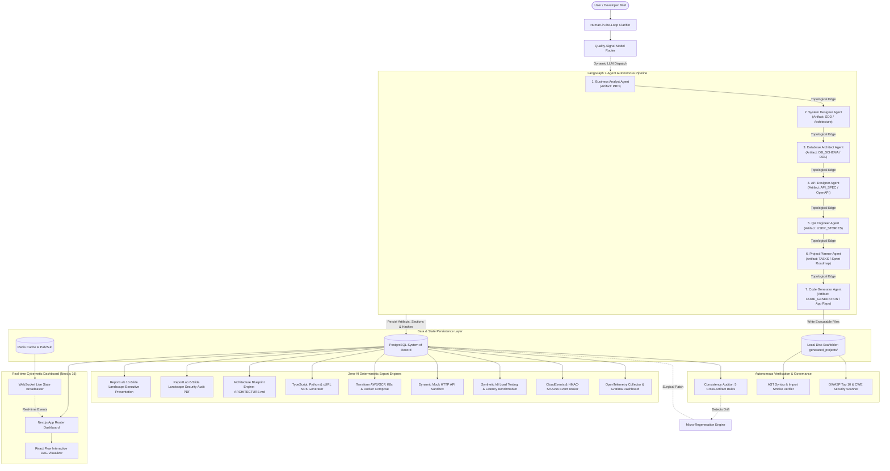

<p align="center">
  
</p>

# AgentFlow: Dependency-Aware Multi-Agent Framework for Deterministic Software Engineering

<p align="center">
  <a href="https://github.com/harishy0406/AgentFlow/actions"></a>
  <a href="https://fastapi.tiangolo.com"></a>
  <a href="https://nextjs.org"></a>
  <a href="https://www.python.org"></a>
  <a href="https://www.postgresql.org"></a>
  <a href="https://redis.io"></a>
  <a href="https://docker.com"></a>
  <a href="LICENSE"></a>
</p>

> **Autonomous 7-Agent DAG Fleet with Artifact-Specific Model Routing, Incremental Dependency Invalidation, Automated Consistency Auditing, and Pure-Code Executive Landscape Presentation Generation.**

---

## 📌 Executive Summary

Modern software development lifecycles are fragmented across disconnected artifacts: **Product Requirement Documents (PRDs)**, **System Architecture Designs (SDDs)**, **Relational Database Schemas (DDLs)**, **RESTful OpenAPI Specifications**, **User Stories**, **Sprint Task Roadmaps**, and **Executable Application Source Code**.

When engineering teams or monolithic LLMs author these artifacts:
1. **Upstream Shifts Trigger Massive Invalidation**: Modifying a single requirement forces engineers to manually review and regenerate all downstream documents or suffer silent architectural drift.
2. **Context Decay & Hallucination**: Monolithic prompts degrade in deterministic guarantees as system specifications expand.
3. **Brute-Force Regeneration is Expensive**: Generic multi-agent frameworks re-execute the entire pipeline from scratch, increasing latency by 400%+ and inflating token consumption.
4. **Undetected Semantic Inconsistencies**: Disconnected generators have no static verification ensuring database foreign keys match API route parameters or user story acceptance criteria.

### The AgentFlow Paradigm
**AgentFlow** resolves these structural failures by modeling the entire software engineering lifecycle as a **typed, dependency-aware Directed Acyclic Graph (DAG)**.

* **Targeted Diff-Aware Selective Invalidation**: Breadth-First Search (BFS) graph traversal recomputes *only* the directly and transitively affected downstream artifacts in strict topological order (`PRD` &rarr; `SDD` &rarr; `DB_SCHEMA` &rarr; `API_SPEC` &rarr; `USER_STORIES` &rarr; `TASKS` &rarr; `CODE_GENERATION`). Stable subgraphs remain untouched.
* **Artifact-Specific Model Routing**: Dispatches each node to the optimal LLM provider (OpenAI GPT-4o, Anthropic Claude 3.5 Sonnet, Claude 3 Haiku, or local Ollama instances) based on benchmarked domain competencies and quality-signal heuristics.
* **Automated Consistency & Semantic Drift Auditing**: Evaluates 5 cross-artifact integrity rules to detect, classify, and surgically auto-resolve semantic mismatches via targeted micro-regenerations.
* **Zero-AI Pure-Code Executive PDF Engines**: Deterministic ReportLab engines render complete, high-fidelity 10-slide architectural slide decks and 6-slide security audit reports in Letter Landscape format with zero LLM dependencies—ensuring 100% factual accuracy and zero hallucinations.
* **Production-Grade Developer Ecosystem**: End-to-end platform featuring AST code verification, local disk scaffolding, dynamic mock API sandboxes, synthetic k6 load testing, multi-language client SDKs (TypeScript, Python, cURL), CloudEvents HMAC-SHA256 webhooks, OpenTelemetry APM instrumentation, and multi-cloud IaC.

---

## 📊 Quantitative Performance Benchmarks & ROI

Empirical evaluation across a standardized 15-project test corpus demonstrates decisive performance advantages over monolithic single-LLM and naive multi-agent architectures:

| Benchmark Metric | Single-LLM Monolith | Multi-Agent (No Graph) | AgentFlow (DAG Fleet) | Advantage |
|---|---|---|---|---|
| **Initial Run Cost (USD)** | $0.0675 | $0.0576 | **$0.0240** | **-58.3% Cost** |
| **Mid-Project Edit Cost** | $0.0675 (100% regen) | $0.0544 (100% regen) | **$0.0085** | **-84.4% Cost** |
| **Average Edit Latency** | 8,500 ms | 11,800 ms | **2,800 ms** | **-76.3% Latency** |
| **Architectural Quality Score** | 0.68 / 1.00 | 0.82 / 1.00 | **0.94 / 1.00** | **+14.6% Quality** |
| **Semantic Drifts Detected** | 4 drifts / project | 2 drifts / project | **0 residual drifts** | **100% Coherent** |
| **Subgraph Invalidation Ratio** | 100% (All Artifacts) | 100% (All Artifacts) | **28.5% (Targeted BFS)** | **71.5% Compute Saved** |
| **Multi-Cloud IaC Parity** | None (Manual) | Generic Dockerfile | **AWS, GCP, K8s, Compose** | **Production-Ready** |

```
Cost & Latency Reduction on Upstream Edits:
Monolithic / Brute Force: [████████████████████████████████████████] 100% Cost ($0.054+) / 11.8s
AgentFlow Selective BFS:  [███████████                             ] 15.6% Cost ($0.0085) / 2.8s
                                ▲ 84.4% Cost Reduction & 76.3% Latency Reduction
```

---

## 🏗️ System Architecture & 7-Agent Fleet Topology



### The 7 Autonomous Engineering Personas
1. **Business Analyst Agent (`business_analyst_node`)**: Synthesizes formal PRDs with user personas, tagged functional requirements (`REQ-01`, `REQ-02`), non-functional SLAs, and success KPIs.
2. **System Designer Agent (`system_designer_node`)**: Converts requirements into distributed architectural blueprints, component topologies, communication patterns, and scalability parameters.
3. **Database Architect Agent (`database_architect_node`)**: Generates normalized PostgreSQL DDLs, relational foreign keys, composite indexing strategies, and complete data dictionaries.
4. **API Designer Agent (`api_designer_node`)**: Emits OpenAPI 3.0 route matrices, request/response JSON schemas, auth scopes, and standardized RFC 7807 error models.
5. **QA Engineer Agent (`qa_engineer_node`)**: Translates requirements and routes into Gherkin BDD Given-When-Then user stories mapped directly to PRD requirement IDs.
6. **Project Planner Agent (`project_planner_node`)**: Deconstructs user stories into phased milestone engineering roadmaps (Sprint 0 through Sprint 3) with story points and gate criteria.
7. **Code Generator Agent (`code_generator_node`)**: Synthesizes production-grade, multi-file application source code (FastAPI backend, SQLAlchemy models, Pydantic schemas, controllers, tests, and configuration).

---

## ⚡ Core Graph Mechanics & Targeted BFS Invalidation

```python
ARTIFACT_DEPENDENCY_MAP = {
    "PRD":              [],
    "SDD":              ["PRD"],
    "DB_SCHEMA":        ["SDD"],
    "API_SPEC":         ["SDD", "DB_SCHEMA"],
    "USER_STORIES":     ["PRD", "API_SPEC"],
    "TASKS":            ["USER_STORIES", "API_SPEC"],
    "CODE_GENERATION":  ["DB_SCHEMA", "API_SPEC", "TASKS"],
}
```

* **Cryptographic Section Hashing**: Every markdown section is hashed using normalized SHA-256 (`compute_content_hash`). Unchanged sections result in instantaneous no-ops.
* **Breadth-First Search Invalidation (`recompute_subgraph`)**: Traverses self-referential graph traces (`section_traces`) to discover all transitively affected downstream sections.
* **Topological Regeneration**: Affected sections are re-executed in strict topological sequence. Stable branches of the DAG remain untouched, preserving execution state and drastically minimizing API spend.

```
Selective BFS Invalidation Flow:
User edits DB_SCHEMA (e.g. adds 'tenant_id' to users table)
   │
   ├── PRD:              [UNTOUCHED / FRESH]
   ├── SDD:              [UNTOUCHED / FRESH]
   ├── DB_SCHEMA:        [EDITED - Version Increment]
   │       │
   │       └── Traversal finds affected downstream sections:
   │               ├── API_SPEC:         [DIRTY -> Stale -> Regenerated]
   │               ├── USER_STORIES:     [UNTOUCHED / FRESH]
   │               ├── TASKS:            [DIRTY -> Stale -> Regenerated]
   │               └── CODE_GENERATION:  [DIRTY -> Stale -> Regenerated]
```

---

## 📑 Deterministic Pure-Code PDF Presentation & Report Engines

To eliminate LLM hallucinations in executive deliverables, AgentFlow generates all presentation decks and audit reports **deterministically in pure Python code using ReportLab**:

### 1. 10-Slide Architectural Presentation Deck (`pdf_presentation.py`)
* **Strict Landscape Format**: Letter Landscape (`11 x 8.5 in` / `792 x 612 pt`).
* **Two-Pass `NumberedSlideCanvas`**: Dynamic total page evaluation, corporate branding logo (`assets/PDF_Logo-white.png`), running headers, and `Slide X of Y` footers.
* **Dual Visual Themes**:
  * **Executive Dark Midnight Theme**: `#0B0F17` Midnight canvas, `#FFFFFF` headers, `#E2E8F0` body typography, `#38BDF8` sky blue accents, and `#34D399` verified badges.
  * **Printable Slate Light Theme**: `#F8FAFC` Canvas background, `#0F172A` text, `#0284C7` accents, and high-contrast borders for office printing.
* **Complete 10-Slide Agenda**:
  1. Title & Executive Mission Brief
  2. Table of Contents & Slide Agenda (with internal PDF link anchors)
  3. Executive Summary & Readiness Scorecard
  4. System Design & Component Topology
  5. Relational Data Models & Database Schema
  6. REST API Specifications & Service Contracts
  7. Codebase Architecture & File Tree Explorer
  8. Engineering Roadmap & Implementation Sprints
  9. CloudOps & Multi-Cloud Infrastructure (IaC)
  10. Security Compliance, OWASP Audit & Cryptographic Signoff

### 2. 6-Slide Enterprise Security Assessment PDF Report (`pdf_security_report.py`)
* **Executive Security Grade & Audit Score**: Letter grade (`A+` to `F`) calculated across 13 AST security rules and active findings.
* **OWASP Top 10 & CWE Severity Radar**: Breakdown of Critical, High, Medium, and Low vulnerabilities with remediation SLAs.
* **Attack Surface Profile**: Comprehensive perimeter analysis covering mutating HTTP routes, database ingress paths, and webhook listener exposure.
* **STRIDE Threat Modeling Matrix**: Systematic threat breakdown across Spoofing, Tampering, Repudiation, Information Disclosure, Denial of Service, and Elevation of Privilege.
* **Vulnerability Findings & Actionable Patch Register**: Granular register detailing Rule ID, CWE reference, affected file, vulnerable snippet, and recommended patch code.
* **Defense-in-Depth Roadmap**: Prioritized P0/P1/P2 mitigation and infrastructure hardening plan.

### 3. Architecture Blueprint Markdown Engine (`markdown_blueprint.py`)
* Compiles the complete system architecture into publication-grade `ARCHITECTURE.md` with Mermaid diagrams, SQL schemas, OpenAPI route tables, and sprint roadmaps.

---

## 🛠️ Enterprise Platform Engines & Capabilities

| Engine Module | Technical Responsibility & Capabilities |
|---|---|
| **AST Code Scaffolder & Tester** | Parses multi-file code blocks; scaffolds projects to disk under `generated_projects/<slug>/`; runs Python AST syntax and import smoke validation. |
| **Consistency Auditor & Drift Engine** | Evaluates 5 cross-artifact rules; tracks drift in `drift_records`; triggers surgical micro-regenerations (`micro_regen.py`) to heal schema/route drifts without full re-runs. |
| **Interactive AI Copilot** | Natural-language conversational Q&A and direct conversational mutation of DAG sections (`modify_project_via_chat`). |
| **Dynamic Mock API Sandbox** | Executes simulated HTTP requests against OpenAPI routes with status code overrides, latency simulation, and schema-compliant response payloads. |
| **Synthetic k6 Load Tester** | Synthesizes k6 scripts; calculates RPS, p50/p90/p95/p99 latency percentiles, error rates, and caching recommendations across 5 test profiles. |
| **Multi-Language Client SDKs** | Generates type-safe SDK packages in **TypeScript**, **Python**, and **cURL** CLI with `package.json` and `setup.py` manifests. |
| **Webhook & CloudEvents Broker** | CloudEvents 1.0 specifications, HMAC-SHA256 signature generator, idempotent consumer handlers, and RabbitMQ dead-letter exchange topology. |
| **OpenTelemetry & APM Engine** | SRE Golden Signals catalog, Prometheus scraper YAML, OpenTelemetry collector configuration, and ready-to-import Grafana JSON dashboards. |
| **Semantic API Changelog Engine** | Detects breaking OpenAPI contract changes, calculates SemVer increments (Major/Minor/Patch), and emits Keep-a-Changelog markdown. |
| **Multi-Cloud IaC Engine** | Generates production Terraform (AWS ECS, GCP Cloud Run), Kubernetes deployment manifests, and Docker Compose services. |
| **Architecture Decision Records (ADRs)** | Synthesizes formal MADR-format Architecture Decision Records documenting context, options considered, and trade-offs. |
| **GraphQL Schema & Resolvers** | Converts SQL DDL to GraphQL SDL types, queries, mutations, and Strawberry Python / Apollo TypeScript resolvers. |
| **API Gateway Config Generator** | Generates edge reverse-proxy configurations for **Kong** (declarative), **Nginx**, **Envoy**, and **Traefik** with rate-limiting and CORS. |
| **Synthetic Seed Data Generator** | Analyzes entity relationships; generates SQL inserts, FactoryBoy Python classes, and Prisma seed scripts. |
| **Multi-Project Workspaces** | Orchestrates multi-repo distributed architectures; validates cross-service contracts and foreign entity alignment. |
| **Database Migration Engine** | Generates Alembic Python migration scripts and Flyway SQL versioned files directly from `DB_SCHEMA` DDL. |
| **CI/CD Pipeline Generator** | Generates production GitHub Actions and GitLab CI workflows with linting, testing, Docker build, and deployment stages. |

---

## 💻 Cybernetic Dashboard UI (Next.js 16)

AgentFlow includes an executive cyber-dashboard built on **Next.js 16 (App Router)** and **Tailwind CSS**, featuring 17 operational workspaces:

1. **Create & Clarify (`create`)**: Project intake form, interactive HITL clarification questionnaire, and one-click Starter Architecture Presets.
2. **Portfolio (`projects`)**: Workspace project management, deep cloning, and workspace assignment.
3. **Dependency Graph (`graph`)**: Interactive React Flow visualizer rendering artifacts as typed nodes with color-coded freshness badges (`fresh`, `stale`, `regenerating`, `drifted`), edge traces, and freshness audit controls.
4. **Artifacts & Diffing (`artifacts`)**: Section-level markdown editor with side-by-side diff viewer (`DiffViewer.js`), version history rollback, and individual section recomputation triggers.
5. **Code Studio (`code`)**: File tree explorer, code viewer/editor, one-click Python AST smoke testing, and ZIP export.
6. **Workspaces & Microservices (`workspaces`)**: Distributed microservice workspace manager with cross-service API contract validation and foreign entity alignment.
7. **Consistency & Drift (`drifts`)**: Drift auditor view with severity badges, rule descriptions, and one-click micro-regeneration auto-fixes.
8. **Observability Metrics (`metrics`)**: Real-time token consumption meters, cost tracking (USD), latency charts, and quality signal scorecards.
9. **Timeline & Audit Trail (`timeline`)**: Chronological audit log of all section modifications, version snapshots, and agent runs.
10. **Benchmark Evaluations (`evaluations`)**: 15-project evaluation corpus runner comparing Single-LLM, Multi-Agent No-Graph, and AgentFlow baselines.
11. **Security & Vulnerabilities (`security`)**: OWASP Top 10 vulnerability scanner, CWE register, STRIDE threat model, and 6-slide landscape PDF security report generator.
12. **Load Testing Studio (`load-testing`)**: k6 script generator, scenario preset simulator (smoke, load, stress, spike, soak), RPS throughput, and latency percentiles.
13. **DevOps & Contracts (`devops`)**: OpenAPI 3.0 specification download, Postman Collection export, CI/CD pipeline generator, and Alembic/Flyway database migrations.
14. **Mock API Sandbox (`api-sandbox`)**: Real-time interactive HTTP execution sandbox simulating API responses with status code overrides and latency sliders.
15. **SDK Generator (`sdks`)**: Multi-language type-safe client SDK generator for TypeScript, Python, and cURL with bundle ZIP downloads.
16. **Webhooks & APM (`webhooks-apm`)**: CloudEvents 1.0 event catalog, HMAC-SHA256 signature simulator, OpenTelemetry collector config, and Grafana dashboard JSON downloader.
17. **Changelog & CloudOps (`changelog-cloudops`)**: Semantic API changelog with breaking change detection, Architecture Decision Records (ADR), GraphQL SDL/resolvers, API Gateway configs (Kong, Nginx, Envoy, Traefik), Synthetic Seed Data (SQL, FactoryBoy, Prisma), Architecture Blueprint markdown exporter (`ARCHITECTURE.md`), and the 10-slide Executive Landscape Presentation PDF Generator (Dark Midnight / Printable Slate).

---

## 📡 Complete REST & WebSocket API Catalog

The backend exposes an exhaustive, versioned RESTful and WebSocket API (`backend/app/main.py`):

| Endpoint Route | Method | Description |
|---|---|---|
| `/projects` | `POST` | Create a new project from raw user brief |
| `/projects` | `GET` | List all existing projects with statistics |
| `/projects/{id}` | `GET` | Retrieve complete project state & DAG nodes |
| `/projects/{id}/clarify` | `POST` | Submit HITL clarification questionnaire |
| `/projects/{id}/seed-template` | `POST` | Initialize project with pre-built template |
| `/projects/{id}/generate` | `POST` | Execute full LangGraph 7-agent pipeline |
| `/projects/{id}/artifacts` | `GET` | Get all artifact nodes, sections & hashes |
| `/projects/{id}/sections/{section_id}` | `PUT` | Edit section & trigger selective invalidation |
| `/projects/{id}/sections/{section_id}/versions` | `GET` | List historical version snapshots |
| `/projects/{id}/sections/{section_id}/rollback` | `POST` | Rollback section to previous version number |
| `/projects/{id}/audit` | `POST` | Run Consistency Auditor across all artifacts |
| `/projects/{id}/drifts` | `GET` | Retrieve active & resolved drift records |
| `/projects/{id}/drifts/{drift_id}/fix` | `POST` | Execute micro-regeneration auto-fix |
| `/projects/{id}/code-files` | `GET` | List scaffolded repository files on disk |
| `/projects/{id}/code-files` | `PUT` | Selectively patch code file content |
| `/projects/{id}/verify-code` | `GET` | Run Python AST syntax & import smoke tests |
| `/projects/{id}/presentation-pdf` | `GET` | Download 10-slide architectural deck (`.pdf`) |
| `/projects/{id}/preview-presentation-pdf` | `GET` | Open inline preview of architectural deck |
| `/projects/{id}/presentation-metadata` | `GET` | Get slide count, theme options & metadata |
| `/projects/{id}/security-report-pdf` | `GET` | Download 6-slide security audit report (`.pdf`) |
| `/projects/{id}/preview-security-report-pdf` | `GET` | Open inline preview of security audit report |
| `/projects/{id}/blueprint-markdown` | `GET` | Get complete `ARCHITECTURE.md` blueprint text |
| `/projects/{id}/download-blueprint` | `GET` | Download `ARCHITECTURE.md` as file attachment |
| `/projects/{id}/security-audit` | `GET` | Retrieve cached OWASP vulnerability audit |
| `/projects/{id}/security-audit/run` | `POST` | Execute live OWASP security scan |
| `/projects/{id}/security-analysis` | `GET` | Get STRIDE threat model & attack surface |
| `/projects/{id}/load-test` | `POST` | Execute synthetic k6 load test benchmark |
| `/projects/{id}/sdk-catalog` | `GET` | List multi-language SDK packages |
| `/projects/{id}/sdk/{lang}/bundle` | `GET` | Download TypeScript/Python/cURL SDK bundle |
| `/projects/{id}/events` | `GET` | Get CloudEvents catalog & webhook dispatchers |
| `/projects/{id}/events/simulate` | `POST` | Simulate signed HMAC-SHA256 webhook event |
| `/projects/{id}/telemetry` | `GET` | Get OpenTelemetry APM & Prometheus metrics |
| `/projects/{id}/telemetry/grafana-dashboard` | `GET` | Download ready-to-import Grafana JSON |
| `/projects/{id}/changelog` | `GET` | Get semantic changelog & SemVer version |
| `/projects/{id}/changelog/detect-breaking` | `POST` | Analyze API deltas for breaking changes |
| `/projects/{id}/iac-catalog` | `GET` | Get multi-cloud Terraform, K8s & Docker IaC |
| `/projects/{id}/iac/{provider}/bundle` | `GET` | Download cloud IaC deployment bundle |
| `/projects/{id}/graphql` | `GET` | Get GraphQL SDL schema & resolvers |
| `/projects/{id}/seed-data` | `GET` | Get synthetic seed data entities (SQL/JSON) |
| `/projects/{id}/openapi-spec` | `GET` | Download OpenAPI 3.0 YAML specification |
| `/projects/{id}/postman-collection` | `GET` | Download Postman Collection v2.1 JSON |
| `/projects/{id}/cicd-pipeline` | `GET` | Get GitHub Actions & GitLab CI workflows |
| `/projects/{id}/migrations` | `GET` | Get Alembic & Flyway DB migration scripts |
| `/projects/{id}/mock-routes` | `GET` | List interactive mock HTTP sandbox endpoints |
| `/projects/{id}/mock-sandbox` | `POST` | Execute mock API call with simulated payload |
| `/projects/{id}/assistant/ask` | `POST` | Conversational Q&A over project specifications |
| `/projects/{id}/assistant/chat-modify` | `POST` | Natural-language conversational DAG mutation |
| `/projects/{id}/health` | `GET` | Overall project health scorecard (0-100) |
| `/workspaces` | `GET` / `POST` | List and create multi-project workspaces |
| `/workspaces/{id}/validate-contracts` | `GET` | Validate cross-service API & schema contracts |
| `/ws/{project_id}` | `WS` | Real-time WebSocket connection for live events |

---

## 🐳 Docker Compose & Observability Infrastructure

AgentFlow includes an enterprise multi-container stack orchestrated via Docker Compose:

| Service | Port | Description | Access / Credentials |
|---|---|---|---|
| **Backend API** | `8000` | FastAPI Multi-Agent Engine | [http://localhost:8000/docs](http://localhost:8000/docs) |
| **Dashboard UI** | `3000` | Next.js 16 Cyber Dashboard | [http://localhost:3000](http://localhost:3000) |
| **PostgreSQL** | `5432` | Relational Storage & Artifact Nodes | `postgres / postgres` |
| **Redis** | `6379` | Cache, Pub/Sub & Agent Queues | Default |
| **Adminer** | `8080` | Web Database Management GUI | [http://localhost:8080](http://localhost:8080) |
| **Prometheus** | `9090` | Time-Series Metrics Scraper | [http://localhost:9090](http://localhost:9090) |
| **Grafana** | `3001` | Observability & APM Dashboards | `admin / admin` at [http://localhost:3001](http://localhost:3001) |
| **RabbitMQ** | `5672`, `15672` | Message Broker & Management UI | `agentflow / agentflow` at [http://localhost:15672](http://localhost:15672) |
| **OTel Collector** | `4317`, `4318` | OpenTelemetry Traces Ingestion | gRPC (`4317`), HTTP (`4318`) |
| **Ollama (Optional)**| `11434` | Offline Local LLM Execution | Profile: `offline-ai` |

```bash
# Start core application, database, and observability services
docker compose up -d

# Start with local offline AI engine (Ollama)
docker compose --profile offline-ai up -d
```

---

## 🚀 Quickstart & Local Setup

### ⚡ One-Click Auto Launch (Recommended)
Automatically initializes Python virtual environments, installs dependencies, runs database table migrations, starts FastAPI and Next.js, and opens your browser:

* **Windows**: Run [`start.bat`](file:///h:/PROJECTS/Agents/AgentFlow/start.bat) or `.\start.ps1`
* **Cross-Platform / CLI**: Run `python start.py`

### 1. Manual Backend Setup
```bash
cd backend
python -m venv venv
source venv/bin/activate  # On Windows: venv\Scripts\activate
pip install -r requirements.txt

# Run migrations and start API server
python -m uvicorn app.main:app --host 0.0.0.0 --port 8000 --reload
```

### 2. Manual Dashboard Setup
```bash
cd dashboard
npm install
npm run dev
# Dashboard available at http://localhost:3000
```

### 3. Automated Test Suite
```bash
cd backend
python -m pytest -v
```

---

## 📁 Repository Structure

```
AgentFlow/
├── backend/
│   ├── app/
│   │   ├── agents/            # LangGraph 7-agent nodes, router, auditor, micro-regen
│   │   ├── reports/           # Zero-AI ReportLab PDF engines & markdown blueprint
│   │   ├── services/          # AST scaffolder, mock sandbox, k6 load tester, SDK gen
│   │   ├── models.py          # SQLAlchemy 2.0 schema, DAG nodes, section_traces
│   │   ├── main.py            # FastAPI REST & WebSocket endpoints
│   │   └── config.py          # Environment settings & LLM provider configurations
│   ├── tests/                 # Comprehensive pytest test suite
│   └── requirements.txt       # Python backend dependencies
├── dashboard/
│   ├── app/                   # Next.js 16 App Router pages, components, & api clients
│   │   ├── components/        # React Flow DAG, DiffViewer, Modals, Terminal, Metrics
│   │   ├── lib/               # API clients, WebSocket listeners, utility helpers
│   │   └── globals.css        # Cyberpunk midnight theme tokens & Tailwind styling
│   └── package.json           # Frontend dependencies & Next.js scripts
├── monitoring/                # Prometheus & OpenTelemetry collector configurations
├── docker-compose.yml         # 10-container production orchestration stack
├── start.bat / start.ps1      # Windows one-click automated startup scripts
├── start.py                   # Cross-platform automated bootstrap & health check runner
├── project.md                 # Exhaustive system engineering & operational specification
└── README.md                  # Project overview & architectural guide
```

---

## 📄 License
MIT License. Built for autonomous, deterministic software engineering.
