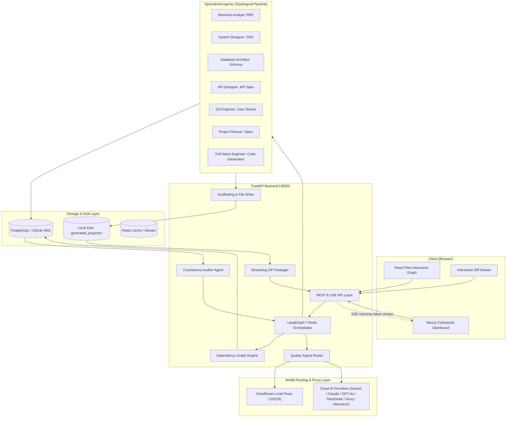
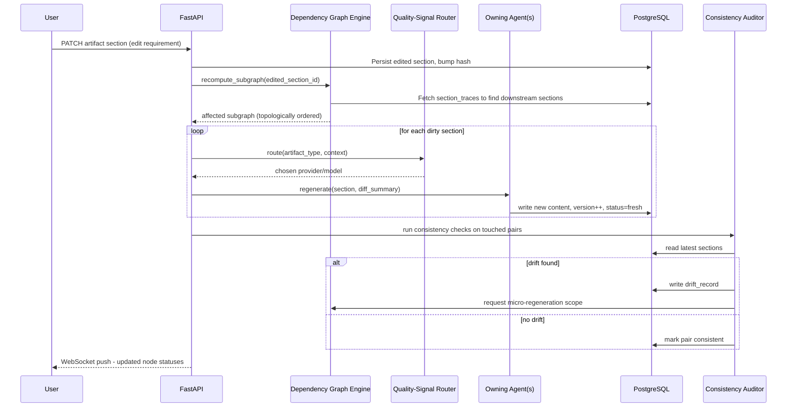

# Architecture Document
## AgentFlow — Dependency-Aware Selective Regeneration for Multi-Agent Software Engineering Artifact Generation

| | |
|---|---|
| **Author** | M Harish Gautham |
| **Document Type** | Architecture Document |
| **Version** | 1.0 |
| **Status** | Draft |

---

## 1. Overview

This document specifies the technical architecture implementing the design described in `design.md`: the full-stack platform, service boundaries, data schema, API contracts, deployment topology, and cross-cutting concerns (security, scalability, observability) required to build AgentFlow.

---

## 2. Tech Stack

| Layer | Technology | Purpose |
|---|---|---|
| Frontend | Next.js (React 18), React Flow, Lucide Icons | Cyberpunk Dark Mode dashboard, real-time graph visualization, diff drawer |
| Backend API | FastAPI (Python 3.11+), Uvicorn | High-throughput async REST, WebSockets, and SSE token streaming |
| Multi-Agent Orchestration | LangGraph & NetworkX | 7-node topological agent execution graph, conditional routing, state cycles |
| Relational Store | PostgreSQL / SQLite (WAL mode) | Dual-engine support via SQLAlchemy: auto-fallbacks to SQLite WAL with zero setup |
| Disk Scaffolding | Python Regex Parser & `Pathlib` | Multi-file code writer generating runnable trees to `generated_projects/<slug>/` |
| Archive Engine | Python `zipfile` | In-memory on-the-fly streaming ZIP packaging for one-click project downloads |
| Cache & Event Mesh | Redis (optional local memory fallback) | Real-time event streaming, token bucket rate limiter, model routing scores |
| Vector Store | Pinecone (optional) | Semantic context retrieval and fine-grained section traceability inference |
| LLM Providers | OmniRoute Local Proxy + Multi-Provider SDKs | Routes through OmniRoute (`http://localhost:20128/v1`) or direct API providers (Gemini, Claude, OpenAI, DeepSeek, Groq) |
| Unified Launcher | Python `start.py` / `.bat` / `.ps1` | Automated single-command supervisor launching backend (:8000) & dashboard (:3000) |
| Containerization | Docker / Docker Compose | Containerized microservice deployment with healthchecks |

---

## 3. High-Level Architecture Diagram



---

## 4. Component Breakdown

### 4.1 Frontend — Next.js + React Flow
- Real-time client rendering the 7-node topological pipeline.
- Custom React Flow node widgets rendering status glows (`fresh`, `stale`, `regenerating`, `drifted`), version chips, quality metrics, and **branded model pills** (Gemini, Claude, GPT-4o, DeepSeek, Groq, Nemotron).
- Slide-out Artifact Drawer supporting raw Markdown rendering, syntax-highlighted multi-file code exploration, and side-by-side git diffs.
- Interactive Project Controls: One-click **"Download Project (.zip)"**, **"Clone Project"**, and starter architecture templates.

### 4.2 Backend — FastAPI & Scaffolding Engine
- Handles async REST endpoints, SSE streams, and WebSocket channels.
- Hosts the **Code Scaffolding Engine** (`scaffolder.py`), which parses generated markdown code blocks matching `### File: <path>\n\`\`\`...\`\`\`` and materializes runnable file trees under `generated_projects/<project_slug>/`.
- Implements selective file patching: when an upstream schema or route changes, only the affected code files on disk are rewritten.
- Provides dynamic in-memory ZIP archiving via `GET /projects/{id}/download-zip`.

### 4.3 Multi-Agent Orchestration — LangGraph
- The 7 specialized agents run in strict topological order:
  `PRD ──▶ SDD ──▶ DB_SCHEMA ──▶ API_SPEC ──┬─▶ USER_STORIES ──▶ TASKS ──▶ CODE_GENERATION`
  (with Schema and API Spec also directly mapped into Code Generation).
- Supports **Human-in-the-Loop (HITL) Clarification**: before starting generation, the BA agent formulates 3–5 targeted architectural clarifying questions for user input.
- Offline Synthesis Engine (`template_seeds.py`): Guarantees 100% demo-ready project initialization and starter template seeding (AI Code Reviewer, FinTech Escrow, HIPAA Telehealth, Multi-Vendor Marketplace) with zero external LLM dependencies.

### 4.4 Data Layer
- **PostgreSQL / SQLite Dual Engine**: Defaults to PostgreSQL if available; automatically switches to high-concurrency SQLite in WAL mode (`PRAGMA journal_mode=WAL; PRAGMA busy_timeout=30000;`) for instant zero-configuration local execution.
- Relational schema stores `workspaces`, `projects`, `artifact_nodes`, `artifact_sections`, `section_traces`, `artifact_versions`, `drift_records`, and `generation_logs`.

### 4.5 OmniRoute Proxy & Model Layer
- Connects seamlessly to a local **OmniRoute** proxy on `http://localhost:20128/v1` with token authentication.
- Automatically handles fallback routing to public cloud providers (Gemini, Anthropic, OpenAI, DeepSeek, Groq) or local Ollama instances.
- Maintains a clean presentation mapping to highlight frontier model specializations in the UI.

---

## 5. API Design (REST & Streaming Endpoints)

| Method | Endpoint | Description |
|---|---|---|
| `POST` | `/projects` | Create a project from brief & clarifications; triggers 7-phase generation |
| `POST` | `/projects/clarify` | Generate 3–5 targeted architectural clarifying questions for HITL review |
| `GET` | `/projects` | List all projects with active node statuses and workspace assignments |
| `GET` | `/projects/{id}` | Fetch project metadata, workspace info, and artifact graph summary |
| `GET` | `/projects/{id}/graph` | Fetch full 7-node dependency graph (nodes, sections, model badges, edges) |
| `GET` | `/projects/{id}/stream` | Server-Sent Events (SSE) real-time token stream during generation |
| `GET` | `/projects/{id}/artifacts/{artifact_type}` | Fetch full content/code bundle of a given artifact |
| `PATCH` | `/projects/{id}/artifacts/{artifact_type}/sections/{section_id}` | Edit a section; triggers diff-aware subgraph recomputation & disk patch |
| `POST` | `/projects/{id}/regenerate` | Manually trigger targeted regeneration of a specific node/section |
| `GET` | `/projects/{id}/download-zip` | Stream complete runnable project repository as `.zip` archive on-the-fly |
| `POST` | `/projects/{id}/clone` | Clone project specification and DAG into a new isolated instance |
| `GET` | `/templates` | List pre-configured architectural starter templates |
| `POST` | `/templates/{id}/seed` | Instant offline seeding of a canonical starter template with 7 nodes |
| `GET` | `/projects/{id}/drift` | List open/resolved cross-document drift records |
| `POST` | `/projects/{id}/drift/{drift_id}/resolve` | Trigger auto-fix (micro-regeneration) or dismiss a drift record |
| `GET` | `/projects/{id}/metrics` | Cost, latency, quality-signal metrics for the project |
| `POST` | `/eval/run` | Kick off an evaluation harness run across a batch of briefs vs. baselines |
| `GET` | `/eval/{run_id}/results` | Fetch evaluation results (cost, latency, quality, drift %, efficiency) |
| `WS` | `/ws/projects/{id}` | Live status updates (node status changes, drift events) |

---

## 6. Database Schema (PostgreSQL / SQLite WAL)

```sql
CREATE TABLE workspaces (
    id UUID PRIMARY KEY,
    name TEXT NOT NULL UNIQUE,
    description TEXT,
    created_at TIMESTAMPTZ DEFAULT now()
);

CREATE TABLE projects (
    id UUID PRIMARY KEY,
    name TEXT NOT NULL,
    brief TEXT NOT NULL,
    clarifications TEXT,
    workspace_id UUID REFERENCES workspaces(id),
    created_at TIMESTAMPTZ DEFAULT now()
);

CREATE TABLE artifact_nodes (
    id UUID PRIMARY KEY,
    project_id UUID REFERENCES projects(id) ON DELETE CASCADE,
    artifact_type TEXT NOT NULL CHECK (
        artifact_type IN ('PRD','SDD','DB_SCHEMA','API_SPEC','USER_STORIES','TASKS','CODE_GENERATION')
    ),
    version INT NOT NULL DEFAULT 1,
    status TEXT NOT NULL DEFAULT 'fresh'
        CHECK (status IN ('fresh','stale','regenerating','drifted')),
    quality_signal_score FLOAT,
    generated_by_model TEXT,
    updated_at TIMESTAMPTZ DEFAULT now()
);

CREATE TABLE artifact_sections (
    id UUID PRIMARY KEY,
    artifact_node_id UUID REFERENCES artifact_nodes(id) ON DELETE CASCADE,
    section_key TEXT NOT NULL,
    content TEXT NOT NULL,
    content_hash TEXT NOT NULL,
    updated_at TIMESTAMPTZ DEFAULT now()
);

CREATE TABLE artifact_versions (
    id UUID PRIMARY KEY,
    artifact_node_id UUID REFERENCES artifact_nodes(id) ON DELETE CASCADE,
    version INT NOT NULL,
    content_snapshot TEXT NOT NULL,
    created_at TIMESTAMPTZ DEFAULT now()
);

CREATE TABLE section_traces (
    downstream_section_id UUID REFERENCES artifact_sections(id) ON DELETE CASCADE,
    upstream_section_id UUID REFERENCES artifact_sections(id) ON DELETE CASCADE,
    PRIMARY KEY (downstream_section_id, upstream_section_id)
);

CREATE TABLE drift_records (
    id UUID PRIMARY KEY,
    project_id UUID REFERENCES projects(id) ON DELETE CASCADE,
    check_name TEXT NOT NULL,
    artifact_a UUID REFERENCES artifact_nodes(id),
    artifact_b UUID REFERENCES artifact_nodes(id),
    section_a UUID REFERENCES artifact_sections(id),
    section_b UUID REFERENCES artifact_sections(id),
    description TEXT NOT NULL,
    status TEXT NOT NULL DEFAULT 'open'
        CHECK (status IN ('open','auto_fixed','dismissed')),
    detected_at TIMESTAMPTZ DEFAULT now(),
    resolved_at TIMESTAMPTZ
);

CREATE TABLE generation_logs (
    id UUID PRIMARY KEY,
    project_id UUID REFERENCES projects(id) ON DELETE CASCADE,
    artifact_node_id UUID REFERENCES artifact_nodes(id) ON DELETE CASCADE,
    triggered_by TEXT NOT NULL
        CHECK (triggered_by IN ('initial_generation','selective_regeneration','micro_regeneration')),
    provider TEXT NOT NULL,
    model TEXT NOT NULL,
    predicted_quality_signal FLOAT,
    tokens_used INT,
    cost_usd NUMERIC(10,4),
    latency_ms INT,
    created_at TIMESTAMPTZ DEFAULT now()
);

CREATE TABLE eval_runs (
    id UUID PRIMARY KEY,
    label TEXT NOT NULL,          -- 'agentflow' | 'single_llm_baseline' | 'multiagent_no_dep_baseline'
    brief_count INT,
    started_at TIMESTAMPTZ DEFAULT now(),
    completed_at TIMESTAMPTZ
);

CREATE TABLE eval_results (
    id UUID PRIMARY KEY,
    eval_run_id UUID REFERENCES eval_runs(id) ON DELETE CASCADE,
    project_id UUID REFERENCES projects(id) ON DELETE CASCADE,
    total_cost_usd NUMERIC(10,4),
    total_latency_ms INT,
    quality_score FLOAT,
    drift_percentage FLOAT,
    regeneration_efficiency FLOAT   -- nodes regenerated / total nodes, on an edit scenario
);
```

> **Note on Storage Engines:** AgentFlow supports dual relational engines. When connecting to PostgreSQL, standard connection pooling is enabled. When running in self-contained SQLite mode (`agentflow.db`), connection events execute `PRAGMA journal_mode=WAL`, `PRAGMA synchronous=NORMAL`, and `PRAGMA busy_timeout=30000` to guarantee high concurrency and eliminate lock contention across asynchronous FastAPI workers.

---

## 7. Data Flow — Mid-Project Edit Scenario



---

## 8. Deployment Architecture

- **Local Development:** `docker-compose` spinning up `frontend`, `backend`, `postgres`, `redis`; Pinecone and LLM providers accessed as external managed services via environment-configured API keys.
- **Staging/Production:** Containerized services deployed behind a reverse proxy (e.g., Nginx/Traefik); FastAPI backend horizontally scalable behind a load balancer; PostgreSQL and Redis run as managed services (e.g., RDS/ElastiCache-equivalent) for durability.
- **CI/CD:** On merge to main — run unit/integration tests, build Docker images, push to registry, deploy to staging; evaluation harness runs as a scheduled/triggered job separate from the request-serving path (to avoid impacting user-facing latency).
- **Environments:** `dev`, `staging`, `prod`, each with isolated Postgres/Redis instances and separate LLM-provider rate-limit budgets.

---

## 9. Scalability Considerations

- **Stateless backend workers:** FastAPI + LangGraph orchestration is designed to be stateless per request, with all durable state in Postgres/Redis, allowing horizontal scaling of backend instances.
- **Async agent execution:** Independent subgraph branches (e.g., regenerating User Stories and Task Breakdown after an API Spec change) can be executed concurrently since LangGraph supports parallel node execution where there is no data dependency.
- **Provider rate limiting:** Redis-backed token-bucket rate limiting per LLM provider to avoid throttling; router treats rate-limited providers as temporarily unavailable and reroutes.
- **Vector store scaling:** Pinecone indexes are namespaced per project to bound query scope and keep retrieval latency low as the number of projects grows.

## 10. Security Considerations

- All LLM provider API keys and database credentials are stored server-side (never exposed to the Next.js client) and injected via environment/secret manager.
- Dashboard authentication via OAuth2/JWT; all REST/WebSocket endpoints require a valid session token scoped to the requesting user's projects.
- Input briefs and artifact content are treated as untrusted text; no generated content is executed — the system only produces documentation artifacts, not executable code, limiting injection risk to prompt-level concerns, which are mitigated via structured output parsing (Pydantic schema validation on every agent output).

## 11. Observability & Monitoring

- Every LLM call is logged in `generation_logs` with provider, model, tokens, cost, and latency — feeding both the dashboard metrics panel and the evaluation harness.
- Structured logging (request id, project id, artifact node id) across the FastAPI layer for tracing a regeneration event end-to-end.
- Dashboard "Metrics Panel" surfaces per-project cost/latency/quality trends and, in evaluation mode, side-by-side comparison against baseline runs stored in `eval_runs` / `eval_results`.

## 12. Evaluation Harness Architecture

- A separate `eval` module drives three pipeline configurations against the same 15–20 project briefs:
  1. **AgentFlow** (full system: graph + router + auditor).
  2. **Single-LLM baseline** (one fixed model generates all six artifacts sequentially, full regeneration on any edit).
  3. **Multi-agent, no dependency tracking** (six specialized agents, but full-pipeline regeneration on any edit, no router, no auditor).
- Each configuration runs an identical **scripted mid-project edit** per brief to measure regeneration efficiency and drift under a controlled scenario.
- Results are persisted to `eval_runs`/`eval_results` and rendered in the dashboard for side-by-side comparison, satisfying the evaluation plan defined in `prd.md`.
